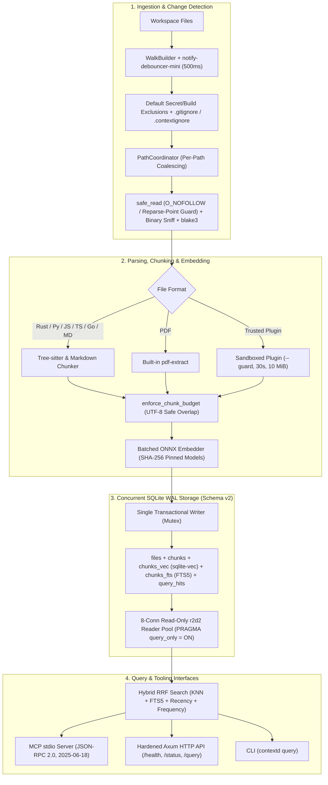

# Architecture

`contextd` is a single-binary, local-first semantic context engine built in Rust. It continuously indexes local workspaces into a SQLite WAL database with vector KNN (`sqlite-vec`) and full-text (`FTS5`) indexes, then serves sub-second hybrid search over **MCP stdio**, **HTTP REST**, and **CLI** — without ever sending code off the machine.

## High-Level Data Flow



## Core Subsystems

### 1. Configuration & Trust Resolution (`src/config.rs`)
- Resolves config in strict precedence order: explicit `--config <path>` → workspace-local `./contextd.toml` → user-global XDG config (`~/.config/contextd/contextd.toml` on Linux, `~/Library/Application Support/contextd/contextd.toml` on macOS) → platform defaults, followed by `CONTEXTD_*` environment variable overrides.
- Enforces **workspace config isolation**: any workspace-local `./contextd.toml` (or `--config` outside the user config directory without `--trust-config`) is marked untrusted. Only `[watch]` and `[chunking]` apply from it; `[server]` and `[storage]` come from user-global config/defaults, and `[plugins]` execution is disabled unless explicitly trusted (`--trust-workspace-plugins`, `--trust-config`, or `security.allow_workspace_plugins = true` in user-global config).

### 2. Daemon, Watcher & Reconciliation (`src/daemon.rs`, `src/indexer/watcher.rs`)
- **Initial Scan**: Streams candidate files from `WalkBuilder` (offloaded to `spawn_blocking`) through a bounded channel into an async worker pool sized to `available_parallelism().clamp(2, 8)`.
- **Startup Reconciliation**: After the initial scan finishes, any indexed paths under active watch roots that were not observed on disk are pruned transactionally, while paths belonging to other watch roots sharing the same DB are preserved.
- **Incremental Watch Loop**: `notify-debouncer-mini` coalesces filesystem bursts (`debounce_ms = 500` default). `PathCoordinator` ensures at most one active indexing task runs per canonical path and automatically schedules one follow-up pass if another edit arrives mid-index.
- **Fast Change Skipping**: Checks `(last_modified_ns, file_size)` against SQLite first, then compares `blake3` content hashes before re-chunking or running ONNX inference.

### 3. Safe File Reading, Filtering & Chunking (`src/indexer/`)
- **Symlink-Safe Reads (`safe_read.rs`)**: Opens regular files strictly beneath canonical watch roots without following symlinks (`openat` with `O_NOFOLLOW | O_CLOEXEC | O_DIRECTORY` per path component on Unix; `FILE_FLAG_OPEN_REPARSE_POINT` + `GetFinalPathNameByHandleW` on Windows).
- **Exclusions (`ignore.rs`)**: Always skips heavy build/dependency directories (`.git`, `node_modules`, `target`, `.venv`, `venv`, `__pycache__`, `dist`, `build`, `.next`, `.nuxt`, `.cache`), secret files (`.env*`, `*.pem`, `*.key`, `id_rsa`, `.netrc`, `.npmrc`, etc.), database/model targets, files over `max_file_size` (2 MiB default), and files containing NUL bytes in the first 8 KiB.
- **Smart Chunking (`chunker.rs`)**: Tree-sitter AST node extraction for Rust, Python, JS/JSX, TS/TSX, and Go; heading-aware splitting for Markdown; `pdf-extract` for PDFs; paragraph splitting for general text. Every chunk passes through `enforce_chunk_budget` for UTF-8-safe newline-snapped overlapping windows (`max_chunk_size = 1500`, `overlap = 150`).
- **Sandboxed Plugins (`plugins.rs`)**: Optional external converters run with `-- <canonical_path>`, `stdin = null`, `kill_on_drop(true)`, 30-second timeout, 10 MiB stdout cap, and strict UTF-8 validation.

### 4. Local ONNX Embeddings & Model Supply Chain (`src/indexer/embeddings.rs`, `src/download.rs`)
- Runs local ONNX Runtime (`ort`) inference with HuggingFace `tokenizers`, supporting `all-minilm-l6-v2` (384d, mean pooling), `all-mpnet-base-v2` (768d, mean pooling), and `bge-small-en-v1.5` (384d, CLS pooling) with L2 normalization and batched inference (`embed_batch`).
- Downloads models from pinned HuggingFace commit revisions and verifies SHA-256 digests before atomic installation into per-model subdirectories under `storage.model_path` (with automatic migration for legacy flat caches).

### 5. Storage, WAL Concurrency & Hybrid Search (`src/storage/db.rs`)
- **Schema v2**:
  - `meta` — stores `schema_version = "2"`, `model_type`, and `embedding_dim` to fail fast on model/dimension mismatches.
  - `files` — path, `last_modified`, `last_modified_ns`, `file_size`, `content_hash` (`blake3`), `last_indexed`.
  - `chunks` — byte offsets (`start_offset`, `end_offset`), text content, optional AST metadata.
  - `chunks_vec` — `sqlite-vec` `vec0` virtual table storing `float[dim]` cosine-distance embeddings.
  - `chunks_fts` — `FTS5` virtual table with Porter stemming (`tokenize='porter unicode61'`).
  - `query_hits` — per-file hit counter for logarithmic frequency ranking.
- **Concurrency Model**: SQLite runs in `WAL` mode (`synchronous = NORMAL`, `busy_timeout = 5000`). All mutations go through a single `Arc<Mutex<Connection>>` writer using atomic transactions (`index_file_chunks`, `delete_file_by_path`). All read/search operations borrow from an 8-connection read-only `r2d2` pool (`SQLITE_OPEN_READ_ONLY`, `PRAGMA query_only = ON`), so queries never block on concurrent indexing.
- **Hybrid Retrieval**:
  1. `sqlite-vec` KNN (`WHERE embedding MATCH ?1 AND k = ?2`) with progressive `k` expansion when file/path/time filters are active, avoiding full-table memory scans.
  2. Tokenized, sanitized FTS5 `OR` query with SQL file/path/time filters applied *before* `LIMIT`.
  3. Normalized Reciprocal Rank Fusion (`k = 60`, clamped to `[0.0, 1.0]`) blended with vector cosine similarity, recency decay (50% every 24h), and logarithmic query frequency boost.
  4. Context lines (`context_before`, `context_after`, `line_start`, `line_end`) are resolved from disk *only* for the final top-N results.

### 6. Serving Layer (`src/api/mod.rs`, `src/mcp/server.rs`, `src/cli.rs`, `src/connect.rs`)
- **HTTP API**: Axum server with `security_middleware` (loopback `Host` validation in unauthenticated mode; constant-time Bearer token enforcement when `auth_token` is set; mandatory auth for non-loopback binds), 64 KiB body limit, 30s timeout, and 64-request concurrency limit.
- **MCP Server**: Async stdio JSON-RPC 2.0 loop supporting protocol versions `2025-06-18`, `2025-03-26`, and `2024-11-05`, 16 MiB line cap, `notifications/cancelled` request cancellation, `spawn_blocking` isolation for CPU/DB work, and read-only tool annotations (`search_context`, `get_status`).
- **Auto-Connect (`connect.rs`)**: Detects and configures 9 AI clients safely using `json5` (JSONC) and `toml_edit` (comment-preserving TOML), refusing to overwrite invalid configs and creating `.bak` backups.

## Security Trust Boundaries

```
Untrusted Repo (files + ./contextd.toml)
   │  [only watch/chunking config, O_NOFOLLOW reads, default secret/binary exclusions,
   │   plugins disabled by default, -- guard on trusted plugins]
   ▼
contextd Core (Indexer + ONNX + SQLite WAL)
   │  [loopback Host validation, mandatory non-loopback Bearer auth,
   │   16 MiB MCP cap, 64 KiB HTTP cap, stderr-only metadata logging]
   ▼
Clients (MCP AI Tools / Local HTTP / CLI)
```

See [`SECURITY.md`](SECURITY.md) for the complete threat model and disclosure process.

## Contributor Pointers

- Start with [`CONTRIBUTING.md`](CONTRIBUTING.md) for the full verification suite and commit conventions.
- Performance-sensitive paths (`chunker.rs`, `storage/db.rs`) have Criterion benchmarks in [`benches/`](benches/).
- To embed `contextd`'s chunking and hybrid search engine directly in a Rust application, see [`examples/embedded_search.rs`](examples/embedded_search.rs) and the crate docs in [`src/lib.rs`](src/lib.rs).
