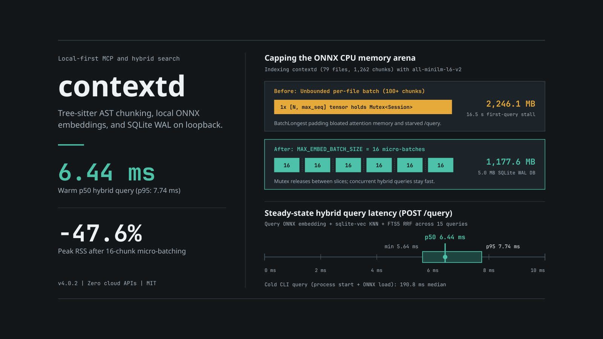
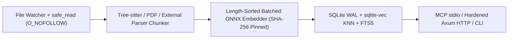

<div align="center">
  

  <h1>contextd</h1>
  <p><b>Local-first, privacy-preserving semantic search &amp; MCP context daemon for AI coding agents.</b></p>
  <p><i>Index any codebase locally with Tree-sitter, ONNX Runtime, and SQLite WAL (<code>sqlite-vec</code> + FTS5) — zero cloud APIs, zero telemetry, sub-second hybrid retrieval.</i></p>

  [](https://github.com/sandy-sachin7/contextd/actions/workflows/ci.yml)
  [](https://github.com/sandy-sachin7/contextd/actions/workflows/audit.yml)
  [](https://crates.io/crates/contextd)
  [](https://github.com/sandy-sachin7/contextd/pkgs/container/contextd)
  [](https://sandy-sachin7.github.io/contextd/)
  [](Cargo.toml)
  [](LICENSE)
</div>

<hr/>

<p align="center">
  
</p>

## Why contextd?

- **100% Local & Private** — Embeddings, vector KNN, and full-text indexing run locally on your machine. Source code never leaves disk.
- **MCP Native (`2025-11-25`)** — Hardened stdio JSON-RPC 2.0 server with one-command auto-configuration for **9 AI tools** (`Claude Desktop`, `Claude Code`, `Cursor`, `VS Code Copilot`, `Copilot CLI`, `OpenCode`, `Continue`, `Antigravity`, `Codex`).
- **True Hybrid Search** — Combines `sqlite-vec` KNN vector similarity and tokenized SQLite FTS5 keyword search via normalized Reciprocal Rank Fusion (RRF), plus recency decay and frequency signals.
- **Polyglot AST Chunking** — Tree-sitter semantic splitting for Rust, Python, JavaScript/JSX, TypeScript/TSX, and Go, plus Markdown header splitting, built-in PDF extraction, and timeout- and output-capped external parser subprocesses.
- **Concurrent SQLite WAL Engine** — Dedicated read-only `r2d2` reader pool, single transactional writer, `blake3` incremental hashing, and batched ONNX Runtime inference.
- **Hardened by Default** — Loopback-only binding with DNS-rebinding `Host` checks, mandatory Bearer auth on non-loopback binds, untrusted workspace config isolation, `O_NOFOLLOW` symlink-safe reads, default secret/binary exclusions, and SHA-256 pinned model downloads.

## 30-Second Quick Start

### Try the Interactive Playground

Downloads a SHA-256 verified binary (if needed), indexes the current workspace in an isolated temp directory, and runs a sample hybrid query:

```bash
curl -fsSL https://raw.githubusercontent.com/sandy-sachin7/contextd/main/scripts/playground.sh | bash
```

### Install

**Linux & macOS (SHA-256 verified binary):**
```bash
curl -fsSL https://raw.githubusercontent.com/sandy-sachin7/contextd/main/scripts/install.sh | bash
```

**Cargo (Crates.io, requires Rust 1.95+):**
```bash
cargo install contextd --locked
```

**Windows (PowerShell, SHA-256 verified binary):**
```powershell
irm https://raw.githubusercontent.com/sandy-sachin7/contextd/main/scripts/install.ps1 | iex
```

**Docker (GHCR):**
```bash
docker run --rm -p 127.0.0.1:3030:3030 \
  -e CONTEXTD_AUTH_TOKEN=replace-with-strong-token \
  -v "$PWD:/workspace:ro" \
  ghcr.io/sandy-sachin7/contextd
```

**Homebrew (macOS/Linux, built from source):**
```bash
brew install --HEAD --build-from-source ./homebrew/contextd.rb
```

### Index & Connect Your AI Tools

```bash
# 1. Download and SHA-256 verify the default ONNX embedding model
contextd setup

# 2. Start the background indexer & HTTP API (watches current workspace)
contextd daemon

# 3. Auto-configure all detected AI tools (backs up existing configs to .bak)
contextd connect --all
```

## Architecture



- **Ingestion**: `WalkBuilder` + `notify-debouncer-mini` (`500ms` default debounce) with bounded concurrency (`available_parallelism().clamp(2, 8)`), per-path coalescing, `O_NOFOLLOW` / reparse-point-safe file reads, binary sniffing, and `blake3` change skipping.
- **Storage**: Schema v2 SQLite database in WAL mode with `sqlite-vec` KNN (`chunks_vec`), Porter-stemmed `FTS5` (`chunks_fts`), transactional per-file chunk replacement, and an 8-connection read-only `r2d2` reader pool.
- **Serving**: Zero-blocking async interfaces across MCP stdio (`contextd mcp`), Axum HTTP (`127.0.0.1:3030`), and CLI (`contextd query`).

For a deep dive into concurrency, schema layout, and trust boundaries, see [`ARCHITECTURE.md`](ARCHITECTURE.md).

## Usage

### Subcommands & Global Flags

| Command / Flag | Purpose |
|----------------|---------|
| `contextd daemon [--exit-on-stdin-eof]` | Watch configured paths, maintain the index, and serve the HTTP API (default subcommand) |
| `contextd mcp` | Run as a JSON-RPC 2.0 MCP server over `stdin`/`stdout` (diagnostics on `stderr` only) |
| `contextd setup` | Download and SHA-256 verify the configured ONNX embedding model |
| `contextd query <QUERY> [OPTIONS]` | Execute a one-off hybrid semantic + FTS5 query from the terminal |
| `contextd connect [--all] [--scope user\|project] [--tool <ID>]` | Auto-configure MCP client config files with `.bak` backups |
| `contextd completions <bash\|zsh\|fish>` | Generate shell completion scripts |
| `--config <PATH>` | Explicit TOML config path (global flag, works before or after any subcommand) |
| `--trust-config` | Explicitly trust a `--config` file located outside the user config directory (allows `[server]`, `[storage]`, `[plugins]`) |
| `--trust-workspace-plugins` | Explicitly allow `[plugins]` execution from a workspace-local `./contextd.toml` |

### CLI Queries

```bash
contextd query "authentication middleware"
contextd query "database schema" --limit 10 --min-score 0.5 --file-types rs,sql --context 2
contextd query "release hardening" --paths src/,docs/ --after 2025-01-01 --before 2026-12-31
```

### HTTP REST API

```bash
# Health & index metrics
curl http://127.0.0.1:3030/health
curl http://127.0.0.1:3030/status

# Hybrid search (default limit: 5, max: 100)
curl -X POST http://127.0.0.1:3030/query \
  -H "Content-Type: application/json" \
  -d '{
    "query": "How does auth work?",
    "limit": 5,
    "min_score": 0.5,
    "file_types": ["rs", "py"],
    "context_lines": 2
  }'
```

When `server.auth_token` or `CONTEXTD_AUTH_TOKEN` is configured, include `-H "Authorization: Bearer <token>"` on `/status` and `/query` (loopback `/health` remains accessible for container healthchecks).

### AI Tool Integration (`contextd connect`)

`contextd connect` supports **9 AI tools** out of the box, parsing JSON/JSONC via `json5` and preserving TOML comments via `toml_edit`, refusing to overwrite malformed configs, and writing atomic `.bak` backups:

| Tool | ID | Config Format |
|------|----|---------------|
| **Claude Desktop** | `claude-desktop` | JSON (`mcpServers`) |
| **Claude Code** | `claude-code` | JSON (`mcpServers`) |
| **Cursor** | `cursor` | JSON (`mcpServers`) |
| **VS Code Copilot** | `vscode-copilot` | JSON (`servers`) |
| **Copilot CLI** | `copilot-cli` | JSON (`mcpServers`) |
| **OpenCode** | `opencode` | JSON (`mcp` + `$schema`) |
| **Continue** | `continue` | JSON (`mcpServers[]`) |
| **Antigravity (`agy`)** | `antigravity` | JSON (`mcpServers`) |
| **Codex** | `codex` | TOML (`[mcp_servers.contextd]`) |

### Shell Completions

```bash
contextd completions bash > ~/.local/share/bash-completion/completions/contextd
contextd completions zsh  > ~/.zfunc/_contextd
contextd completions fish > ~/.config/fish/completions/contextd.fish
```

### Embedding Models

| Model | Dimensions | Pooling | Best For |
|-------|------------|---------|----------|
| `all-minilm-l6-v2` (default) | 384 | Mean | General-purpose FP32 semantic search (~91 MB) |
| `all-minilm-l6-v2-q8` | 384 | Mean | Quantized int8 (~22 MB) — faster CPU indexing and lower cold query latency |
| `all-mpnet-base-v2` | 768 | Mean | Higher retrieval accuracy for codebases |
| `bge-small-en-v1.5` | 384 | CLS | Strong speed/quality balance |

Each model is cached in its own subdirectory under `storage.model_path` and verified against pinned HuggingFace commit SHA-256 digests. See [`docs/models.md`](docs/models.md).

## Security Model

`contextd` is engineered to safely index untrusted repositories on developer workstations and containers:

- **Loopback & DNS-Rebinding Defense**: Binds `127.0.0.1:3030` by default and validates the HTTP `Host` header against loopback addresses in unauthenticated mode, blocking browser DNS-rebinding attacks.
- **Mandatory Non-Loopback Auth**: Refuses to start on non-loopback addresses (such as `0.0.0.0`) unless `server.auth_token` or `CONTEXTD_AUTH_TOKEN` is set; tokens are verified in constant time.
- **Workspace Config Isolation**: A repo-local `./contextd.toml` (or an untrusted `--config` outside the user config directory) can only configure `[watch]` and `[chunking]`. `[server]` and `[storage]` remain governed by the user-global config/defaults, and `[plugins]` execution is disabled unless `--trust-workspace-plugins`, `--trust-config`, or `security.allow_workspace_plugins = true` (in user-global config) is explicitly set.
- **Symlink-Safe File Reads & Secret Exclusions**: Files are opened under watch roots without following symlinks (`O_NOFOLLOW` on Unix, reparse-point checks on Windows). Secrets (`.env*`, `*.pem`, `*.key`, `id_rsa`, `.netrc`, `.npmrc`, etc.), binary files, and build/dependency trees (`.git/`, `node_modules/`, `target/`, `.venv/`, etc.) are excluded by default alongside `.gitignore` and `.contextignore`.
- **Supply-Chain Verification**: Embedding models download from pinned HuggingFace revisions verified by SHA-256, and release installers verify binary `SHA256SUMS.txt` checksums.

For supported versions, threat boundaries, and private vulnerability reporting, see [`SECURITY.md`](SECURITY.md).

## Benchmarks & Retrieval Quality (Measured)

### Indexing & Query Latency

Measured on Linux x86_64 (AMD Ryzen 5 5600H, 12 logical CPUs) indexing the `contextd` repository itself (`80–83` files, `897–908` chunks after default lockfile exclusion, length-sorted cross-file ONNX batching):

| Metric | v4.0.2 (`all-minilm-l6-v2`, FP32) | v4.1.0 (`all-minilm-l6-v2`, FP32) | v4.1.0 (`all-minilm-l6-v2-q8`, int8) |
| :--- | :---: | :---: | :---: |
| **Initial Full-Repo Indexing** | 65.14 s | **39.22 s** (1.66× faster) | **33.99 s** (1.92× faster) |
| **Warm HTTP Hybrid Query (`POST /query`)** | 6.44 ms p50 · 7.74 ms p95 | — | **4.84 ms** p50 · **5.69 ms** p95 |
| **Cold CLI Query (`contextd query`)** | 190.8 ms median | — | **112.9 ms** median (1.69× faster) |
| **SQLite Index Size (incl. WAL)** | 9.8 MB | — | **6.5 MB** |
| **Daemon Peak RSS during initial index** | — | — | **988.7 MB** |

### Retrieval Quality Evaluation (36 Queries, Uncontaminated)

Evaluated on the `contextd` repository (`eval/` excluded from the staged copy and `query_hits` reset between modes) across 12 conceptual semantic queries, 12 exact symbol queries, and 12 mixed queries ([`eval/contextd_queries.json`](eval/contextd_queries.json), raw outputs in [`eval/results-fp32.json`](eval/results-fp32.json) and [`eval/results-q8.json`](eval/results-q8.json)):

| Method (`all-minilm-l6-v2-q8`) | Recall@1 | Recall@5 | Recall@10 | MRR | nDCG@10 | Semantic MRR | Exact MRR | Mixed MRR |
| :--- | :---: | :---: | :---: | :---: | :---: | :---: | :---: | :---: |
| `ripgrep` (`rg`, token-ranked) | **0.722** | **0.889** | 0.917 | **0.793** | **0.817** | **0.506** | 0.958 | **0.917** |
| `contextd` FTS5 only | 0.556 | 0.861 | 0.972 | 0.685 | 0.752 | 0.341 | **1.000** | 0.715 |
| `contextd` Vector KNN only | 0.389 | 0.833 | 0.889 | 0.571 | 0.629 | 0.378 | 0.779 | 0.556 |
| `contextd` Hybrid RRF (`recency=0, freq=0`) | 0.472 | 0.861 | **1.000** | 0.649 | 0.719 | 0.433 | 0.958 | 0.555 |
| `contextd` Hybrid Default | 0.556 | 0.806 | 0.972 | 0.676 | 0.736 | 0.379 | **1.000** | 0.647 |

**Honest takeaway:** Hybrid RRF beats both `ripgrep` and vector-only search on `Recall@10` (**0.972–1.000** vs 0.917) and ties FTS5 at **1.000 Exact MRR**, while `all-minilm-l6-v2-q8` matches FP32 within 0.005 MRR (`0.676` vs `0.681`) at nearly half the indexing wall time. `ripgrep` still leads on `Recall@1` and `MRR` when `README.md`, `CHANGELOG.md`, and `docs/` are indexed alongside `src/` because general-text MiniLM scores prose documentation higher than Rust source chunks. Pass `--paths src/` or `--file-types rs` when querying code-only contexts.

Reproduce both benchmarks and retrieval evaluations on any repository (requires `contextd setup` once for the selected ONNX model):

```bash
cargo build --release --locked
python3 scripts/bench_repo.py --target . --model all-minilm-l6-v2-q8
python3 scripts/eval_retrieval.py --model all-minilm-l6-v2-q8
```

For Criterion micro-benchmarks covering AST/text chunking and SQLite WAL (`sqlite-vec` + FTS5) indexing and retrieval:

```bash
cargo bench --locked
# Or generate HTML reports in target/criterion/ via cargo-criterion
bash scripts/bench.sh
```

For large-scale memory footprint validation (10K files / 1K queries), run `python3 scripts/memory_stress_test.py`. Because query vectors are fetched via `sqlite-vec` KNN (`WHERE embedding MATCH ?1 AND k = ?2`) rather than loading table rows into memory, query RAM stays bounded independently of corpus size.

## Documentation & Contributing

- **User Guide (mdBook)**: [sandy-sachin7.github.io/contextd](https://sandy-sachin7.github.io/contextd/)
- **Architecture Deep Dive**: [`ARCHITECTURE.md`](ARCHITECTURE.md)
- **Configuration Reference**: [`docs/book/src/configuration.md`](docs/book/src/configuration.md) & [`contextd.example.toml`](contextd.example.toml)
- **MCP Integration Guide**: [`docs/mcp-integration.md`](docs/mcp-integration.md)
- **Embedded Library Example**: [`examples/embedded_search.rs`](examples/embedded_search.rs) (`cargo run --example embedded_search`)
- **Changelog**: [`CHANGELOG.md`](CHANGELOG.md)
- **Contributing**: [`CONTRIBUTING.md`](CONTRIBUTING.md) & [`CODE_OF_CONDUCT.md`](CODE_OF_CONDUCT.md)

## License

MIT — see [`LICENSE`](LICENSE).
